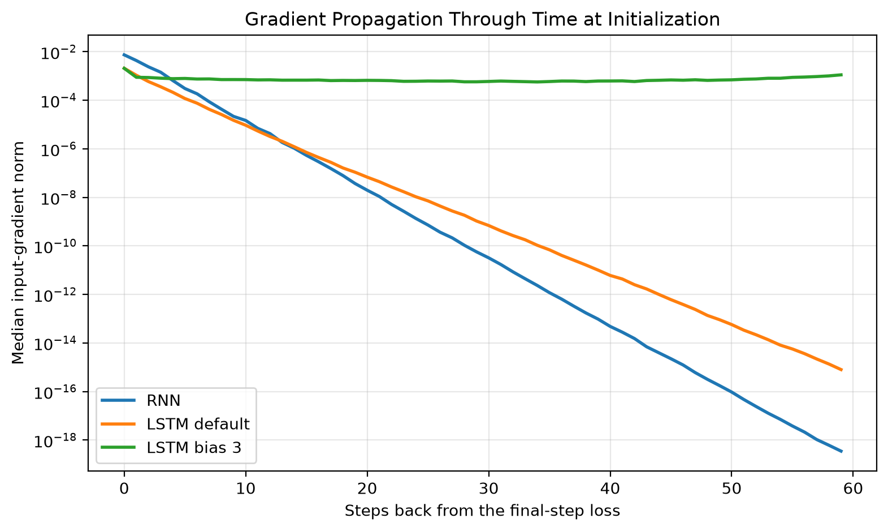

# AIGC-5500 Lab 4 - What Recurrence Can and Cannot Remember

**Student:** Daniel Alejandro Castillo Martin  
**Student ID:** N10019284  
**Course:** Advanced Deep Learning (AIGC-5500-0NA)  
**Professor:** Hossein Pourmodheji

---

Submission for Lab 04 of the Advanced Deep Learning course in the Artificial Intelligence with Machine Learning postgraduate program at Humber Polytechnic.

This project compares RNNs, LSTMs, and GRUs on a delayed-recall task, investigating gradients through time, gate initialization, gradient clipping, and the limits of recurrence.

## Setup

Python version: 3.11.15.

```powershell
python -m venv .venv
.\.venv\Scripts\Activate.ps1
python -m pip install -r requirements.txt
```

On macOS/Linux, activate with:

```bash
source .venv/bin/activate
```

## Run

Open `daniel_alejandro_castillo_martin_LAB4.ipynb`, select the Python environment, and run the cells from top to bottom from the repository root.

The professor's starter is preserved unchanged in `scripts/lab04_starter.py`.

Figures and results are saved under `output/`.

## Task

The first sequence step contains a class label. Subsequent steps contain noise, and the model must recall the label at the final step.

There are four classes, so chance accuracy is 0.25.

## Starter Verification

The unchanged starter achieved 1.000 validation accuracy on the 10-step task after 600 updates and printed `Starter OK.`

## Experiments

The following sections will be added progressively:

1. Recurrent benchmark.
2. Gradients through time.
3. Forget-bias sweep and clipping comparison.
4. Timing and conclusions.

## Benchmark Results

All configurations use hidden size 32, 600 updates, batch size 64,
Adam with learning rate 0.003, and gradient clipping at 1.0.

| Configuration | Length | Seed 0 | Seed 1 | Seed 2 | Mean |
|---|---:|---:|---:|---:|---:|
| RNN | 10 | 1.000 | 1.000 | 0.495 | 0.832 |
| RNN | 30 | 0.248 | 0.251 | 0.264 | 0.254 |
| RNN | 60 | 0.250 | 0.240 | 0.233 | 0.241 |
| LSTM default | 10 | 1.000 | 1.000 | 1.000 | 1.000 |
| LSTM default | 30 | 0.248 | 0.251 | 0.255 | 0.251 |
| LSTM default | 60 | 0.249 | 0.251 | 0.254 | 0.251 |
| LSTM bias 3 | 10 | 1.000 | 1.000 | 1.000 | 1.000 |
| LSTM bias 3 | 30 | 1.000 | 1.000 | 1.000 | 1.000 |
| LSTM bias 3 | 60 | 1.000 | 1.000 | 1.000 | 1.000 |
| GRU default | 10 | 1.000 | 1.000 | 1.000 | 1.000 |
| GRU default | 30 | 0.241 | 0.257 | 0.254 | 0.251 |
| GRU default | 60 | 0.248 | 0.249 | 0.240 | 0.246 |
| GRU bias 3 | 10 | 1.000 | 1.000 | 1.000 | 1.000 |
| GRU bias 3 | 30 | 1.000 | 1.000 | 1.000 | 1.000 |
| GRU bias 3 | 60 | 1.000 | 1.000 | 1.000 | 1.000 |

Default configurations remained near chance accuracy of 0.25 at lengths
30 and 60. Both bias-3 configurations achieved perfect accuracy for
every tested length and seed. The short-task RNN result also showed
seed sensitivity.

### Gate Verification

The initialization check confirmed that slice [32:64] selects the LSTM
forget gate and GRU update gate. Each selected bias vector contained
1.5, giving an effective bias of 3 when bias_ih and bias_hh were summed.

The relationship between benchmark performance and gradient propagation
will be examined in the next experiment.

## Gradients Through Time

Untrained networks were evaluated using 60 steps, 8 input features,
hidden size 32, and batch size 16. Cross-entropy loss used only the
final recurrent output.

For each step, input-gradient L2 norms were computed across features,
averaged across examples, and summarized by the median over seeds
0 through 4.

| Steps back | RNN | LSTM default | LSTM bias 3 |
|---:|---:|---:|---:|
| 0 | 7.434e-03 | 2.077e-03 | 2.070e-03 |
| 9 | 2.165e-05 | 1.490e-05 | 7.127e-04 |
| 29 | 5.675e-11 | 1.055e-09 | 5.765e-04 |
| 59 | 3.493e-19 | 7.996e-16 | 1.115e-03 |



The RNN and default LSTM showed strong gradient decay, consistent
with their longer-sequence benchmark accuracies near chance (0.25).
The bias-3 LSTM preserved stronger gradients to distant inputs and
achieved 1.000 benchmark accuracy at every tested length.

These initialization measurements support an explanation for the
training outcomes but do not track gradients during training.

## Prediction Before the Clipping Comparison

Clipping is expected to limit large parameter gradients and may
improve training stability. It cannot restore gradients that have
already vanished through time.

Given the RNN's measured gradient decay, clipping alone is not
expected to reliably solve the 30-step recall task. Both conditions
may remain near chance accuracy of 0.25.

This prediction is recorded before running the comparison and will
be retained regardless of the outcome.